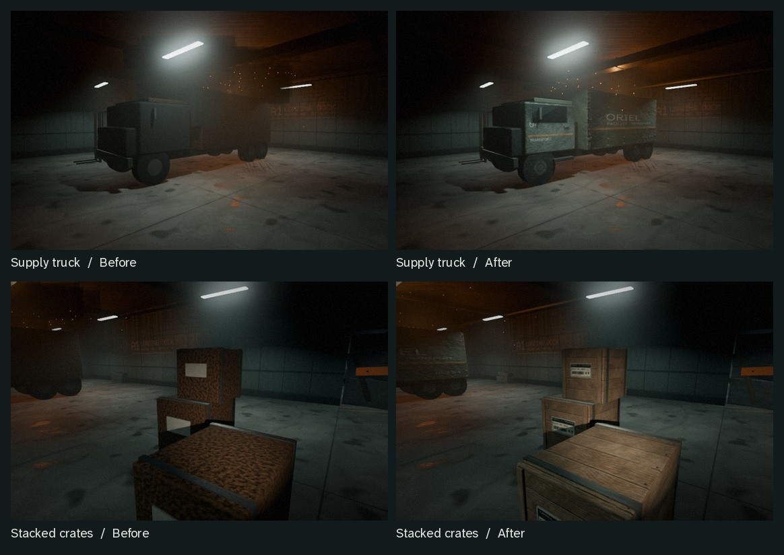
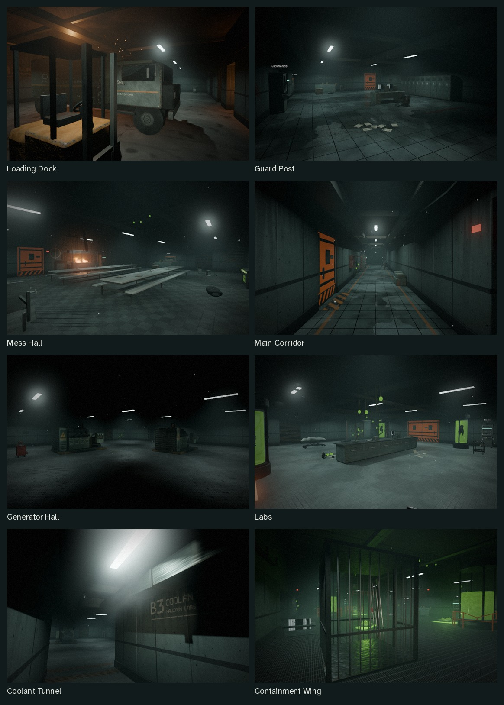

# Halcyon Labs environment review

The map references 78 distinct environment models. The 39 pairs below cover its doors, machines, props, dressing and modular wall. The shared loot catalogue is outside the scenery inventory.

## Loading dock

The before and after views use the same camera positions, powered level and player flashlight in Godot 4.7.2 Forward+.

[Closer views of the truck and crates](images/halcyon-labs/dock-detail.jpg)

## Model pairs

The 59 rebuilt models use a shared 2048-pixel colour atlas and 1024-pixel normal and packed occlusion, roughness and metalness maps. Special surfaces still supply glass, monitor motion, liquid glow and purchase cues. The intact tank uses the existing liquid texture, and the diesel set keeps its own panel atlas. Sixteen baked models and the modular wall keep their existing finishes.

[Open the model contact sheet](images/halcyon-labs/models.jpg) or select a model below to see it from four sides.

| First asset | Second asset | Finish |
|---|---|---|
| [supply truck](../turnarounds/props/supply_truck.png) | [crate stack](../turnarounds/props/crate_stack.png) | The truck gained cab windows, headlamps, steps and transport markings. Raised timber battens frame the crate labels. |
| [crate long](../turnarounds/props/crate_long.png) | [crate large](../turnarounds/props/crate_large.png) | Board seams, knots, nailheads and handling labels carry across both crate sizes. |
| [forklift](../turnarounds/props/forklift.png) | [fuel drum](../turnarounds/props/fuel_drum.png) | The footplate and wheel hubs have tread and lug detail. The fuel drum carries a banded reserve label. |
| [military cases](../turnarounds/props/military_cases.png) | [supply shelving](../turnarounds/props/supply_shelving.png) | Stencilled field cases sit beside the shelving's baked finish. |
| [guard desk](../turnarounds/props/guard_desk.png) | [screen pair](../turnarounds/dressing/screen_pair.png) | The desk has a keyboard, switcher and shift log. The dead monitor reflects a dim window shape. |
| [locker row](../turnarounds/props/locker_row.png) | [filing cabinets](../turnarounds/props/filing_cabinets.png) | Locker vents, ID plates, drawer cards and printed folders break up the metal fronts. |
| [barricade](../turnarounds/props/barricade.png) | [debris pile](../turnarounds/doors/debris_pile.png) | Timber grain, worn sandbag vinyl and a battered service cabinet distinguish the salvaged pieces. |
| [bulkhead door](../turnarounds/doors/bulkhead_door.png) | [bulkhead door wide](../turnarounds/doors/bulkhead_door_wide.png) | Access plates pick out the pull side on both widths. |
| [roll shutter](../turnarounds/doors/roll_shutter.png) | [freezer door](../turnarounds/doors/freezer_door.png) | Wear on the shutter housing and a storage mark on the cold-room leaf distinguish the two doors. |
| [vent grate](../turnarounds/doors/vent_grate.png) | [vent grate wide](../turnarounds/doors/vent_grate_wide.png) | Both sizes have brushed louvres and recessed, weathered bolt heads. |
| [mess table](../turnarounds/props/mess_table.png) | [overturned table](../turnarounds/props/overturned_table.png) | The upright table carries divided trays. The fallen table exposes its laminate and scuffed feet. |
| [kitchen line](../turnarounds/props/kitchen_line.png) | [serving counter](../turnarounds/props/serving_counter.png) | Burner rings, brushed splash guards and recessed food pans give each surface a purpose. |
| [mess spill](../turnarounds/dressing/mess_spill.png) | [vending machine](../turnarounds/props/vending_machine.png) | Dropped trays share the tableware finish. The machine has selection buttons and side lettering. |
| [janitor cart](../turnarounds/props/janitor_cart.png) | [water cooler](../turnarounds/props/water_cooler.png) | Both retained their existing baked maps. |
| [generator](../turnarounds/props/generator.png) | [tool cart](../turnarounds/props/tool_cart.png) | The diesel set retained its dedicated panel atlas. The cart retained its baked finish. |
| [fallen barrels](../turnarounds/props/fallen_barrels.png) | [pipe run 3](../turnarounds/dressing/pipe_run_3.png) | Banded and labelled drums sit against insulated steam and water lines. |
| [floor cables](../turnarounds/dressing/floor_cables.png) | [pipe run 6](../turnarounds/dressing/pipe_run_6.png) | Braided cable jackets and banded supply lines distinguish the two utilities. |
| [hanging strip](../turnarounds/dressing/hanging_strip.png) | [hazard sign](../turnarounds/dressing/hazard_sign.png) | Worn metal and a pale tube distinguish the loose fitting. The warning plate has printed type. |
| [lab bench](../turnarounds/props/lab_bench.png) | [jar shelf](../turnarounds/props/jar_shelf.png) | Drawer cards, instrument controls and labelled jar lids give the bench and shelving a shared lab identity. |
| [lab papers](../turnarounds/dressing/lab_papers.png) | [lab floor wreck](../turnarounds/dressing/lab_floor_wreck.png) | Intake forms and a shift clipboard appear among the loose papers and overturned stools. |
| [lab cart](../turnarounds/props/lab_cart.png) | [gas cylinder rack](../turnarounds/props/gas_cylinder_rack.png) | Both retained their existing baked maps. |
| [covered gurney](../turnarounds/props/covered_gurney.png) | [body bag](../turnarounds/dressing/body_bag.png) | Woven linen with stitched stripes contrasts with dark vinyl, zipper teeth and a paper tag. |
| [wheelchair](../turnarounds/props/wheelchair.png) | [office chair tipped](../turnarounds/props/office_chair_tipped.png) | Both retained their existing baked maps. |
| [specimen tank](../turnarounds/props/specimen_tank.png) | [big tank cracked](../turnarounds/props/big_tank_cracked.png) | The intact tank now samples the liquid texture. The cracked vessel has banded steel and its existing glowing liquid. |
| [big tank shattered](../turnarounds/props/big_tank_shattered.png) | [research room](../turnarounds/props/research_room.png) | Weathering picks out the empty vessel collar, the observation frame and its overgrowth. |
| [holding cell](../turnarounds/props/holding_cell.png) | [specimen vault](../turnarounds/machines/specimen_vault.png) | The cell has a keypad and tread plate. The archive has a marked hatch and vent panels. |
| [toppled console](../turnarounds/props/toppled_console.png) | [server rack tipped](../turnarounds/props/server_rack_tipped.png) | The console has a control face and side vents. The server rack retained its baked finish. |
| [weapon rack](../turnarounds/machines/weapon_rack.png) | [weapon rack cold](../turnarounds/machines/weapon_rack_cold.png) | Printed inventory plates distinguish the rack mounts alongside their existing purchase and frost cues. |
| [med dispenser](../turnarounds/machines/med_dispenser.png) | [reforger](../turnarounds/machines/reforger.png) | Both retained their existing baked maps. |
| [power switch](../turnarounds/machines/power_switch.png) | [exfil hatch](../turnarounds/machines/exfil_hatch.png) | Both retained their existing baked maps. |
| [fire hose cabinet](../turnarounds/props/fire_hose_cabinet.png) | [biohazard bin](../turnarounds/props/biohazard_bin.png) | Both retained their existing baked maps. |
| [vine wall](../turnarounds/dressing/vine_wall.png) | [vine wall small](../turnarounds/dressing/vine_wall_small.png) | Fibrous stems and leaf veins sit beneath the glowing pods on both sizes. |
| [vine pillar](../turnarounds/dressing/vine_pillar.png) | [vine ceiling](../turnarounds/dressing/vine_ceiling.png) | Wrapped stems and hanging strands use the same fibrous surface as the wall growth. |
| [fenlight spill](../turnarounds/dressing/fenlight_spill.png) | [riot shield cases](../turnarounds/props/riot_shield_cases.png) | Veining breaks up the low root mat. The cases retained their baked finish. |
| [catwalk office](../turnarounds/dressing/catwalk_office.png) | [wall panel](../turnarounds/kit/wall_panel.png) | Tread plates and a dark office window detail the catwalk. The modular wall retained its shared surface materials. |
| [ceiling loading dock](../turnarounds/dressing/ceiling_loading_dock.png) | [ceiling guard post](../turnarounds/dressing/ceiling_guard_post.png) | Duct jackets, seam bands and braided cables distinguish the overhead services. |
| [ceiling mess hall](../turnarounds/dressing/ceiling_mess_hall.png) | [ceiling main corridor](../turnarounds/dressing/ceiling_main_corridor.png) | Ribbed ducts and darker cable runs follow the existing support spans. |
| [ceiling generator hall](../turnarounds/dressing/ceiling_generator_hall.png) | [ceiling labs](../turnarounds/dressing/ceiling_labs.png) | Foil, brushed metal and cable braid distinguish the two utility runs at ceiling height. |
| [ceiling coolant tunnel](../turnarounds/dressing/ceiling_coolant_tunnel.png) | [ceiling containment wing](../turnarounds/dressing/ceiling_containment_wing.png) | The same overhead finishes carry through the low tunnel and tall containment room. |

## Room views

Captured at player height with the power on and the existing baked lighting. The coolant-tunnel steam and dock smoke share a feathered opacity texture so their rectangular particle cards disappear.

[Coolant-tunnel steam comparison](images/halcyon-labs/coolant-steam.jpg)

The final High-quality, three-bounce GPU lightmap bake is pending.
